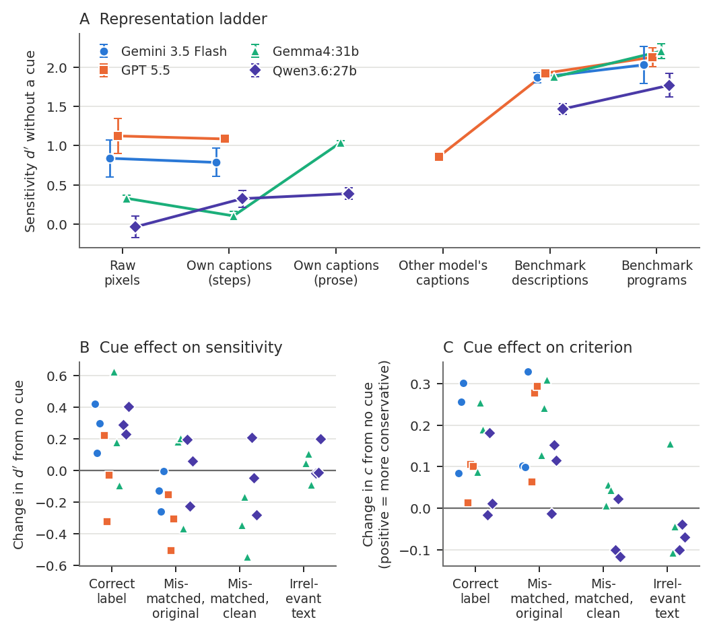
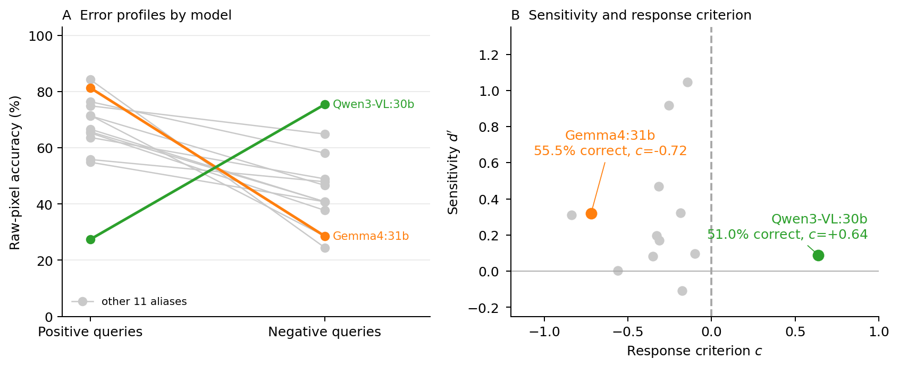
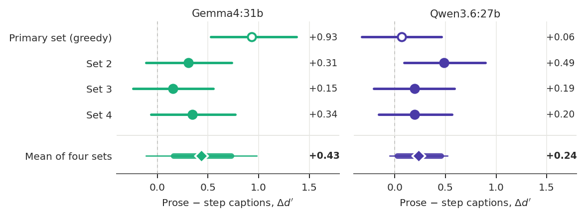

# From supplied structure to self-generated captions in visual rule verification

Code and frozen machine outputs accompanying *From supplied structure to self-generated captions in visual rule verification* (Mohit Vaishnav, Tanel Tammet, Halil Ibrahim Aysel and Meelis Kull).

We compare visual rule verification from images, model-generated captions and descriptions supplied from the benchmark's drawing programs. Controlled experiments in four models examine how much of the supplied-description advantage a captioning pipeline recovers. A broader 15-configuration survey and a complementary human study motivate reporting discrimination, response criterion and answer coverage alongside accuracy. Start with the [implemented evaluation protocol](evaluation/docs/README.md); a plain-language summary is in [`docs/blog.md`](docs/blog.md).

## Highlights from the machine experiments

| Finding | Evidence |
|---|---|
| Program-derived descriptions raise accuracy over images | all 13 paired configurations, +7.0 to +29.1 percentage points (median +17.5) on queries answered under both |
| Answer rates can differ by representation | Qwen3-VL:30b answered 200 image queries but 120 description queries |
| Models' own drawing recipes recover little of that advantage | recovered share near -5% for Gemini 3.5 Flash and GPT 5.5, -14% for Gemma4:31b; Qwen3.6:27b 10-29% across caption sets |
| Prose captions beat recipes on average, with large set-to-set variation | prose minus step d' averaged over four caption sets: +0.43 [0.16, 0.73] (Gemma4:31b), +0.24 [0.02, 0.46] (Qwen3.6:27b) |
| Correct rule cues give higher discrimination estimates than mismatched cues | all nine proprietary and all six open-weight point estimates; uncertainty varies by contrast |



*No-cue sensitivity across input representations (A) and cue effects on sensitivity (B) and criterion (C) in four models.*



*Models with similar image accuracy can lean in opposite directions: one accepts most queries, another rejects most.*



*Prose-minus-recipe sensitivity in each open-weight caption set and the four-set mean. Mean-contrast intervals hold captions fixed; descriptive intervals for future sets span zero in both models.*

## Contents

- `evaluation/`: experiment implementation, prompts, configurations and the [implemented protocol](evaluation/docs/README.md).
- `analysis/`: statistical analysis and figure-generation code, plus frozen machine predictions, all caption sets and machine-only analysis outputs.
- `machine_result/clean_machine_data.csv`: consolidated predictions of the 15-model experiment.
- `docs/blog.md`: plain-language summary of the study.
- `scripts/verify_public_snapshot.py`: integrity and exclusion checks.
- `SNAPSHOT_MANIFEST.json`: SHA-256 inventory.

Manuscript sources/PDFs, human datasets, human-derived result files and figures, and institutional correspondence are excluded.

Personal filesystem prefixes in machine CSV and workbook provenance columns are replaced by `external-results/`; model-cache provenance uses `external-model-cache/`. These are logical source labels, not bundled raw files. Filenames, relative directory suffixes, predictions and model-manifest hashes are retained. SLURM log destinations are relative to the job's working directory. `SNAPSHOT_MANIFEST.json` records the affected files and their original SHA-256 digests; the `sha256` inventory describes the distributed copies.

## Install and verify

```sh
python3 -m venv .venv
. .venv/bin/activate
pip install -r requirements-analysis.txt
python scripts/verify_public_snapshot.py
```

## Reproduce machine analyses

These commands use the included frozen machine predictions and make no model API calls:

```sh
python analysis/patterns_statistics.py --machine-only
python analysis/factorial_ow_secondaries.py
python analysis/factorial_ow_analysis.py
python analysis/factorial_ow_analysis.py --strict
python analysis/factorial_ow_reporting_checks.py
python analysis/factorial_ladder_figure.py
python analysis/factorial_caption_sets_figure.py
python analysis/operational_denominators.py
python analysis/factorial_planned_model.py
```

Bootstrap analyses may take several minutes. The integrity check verifies the original snapshot before regeneration; regenerating outputs can change their hashes. See `analysis/README.md` for additional entry points and dependencies. The frozen provider-model outputs are the reference; new API calls may return different results.

To run new experiments, install `evaluation/` with `pip install -e evaluation`, obtain the benchmark inputs and configure provider credentials. See `evaluation/README.md`. Provider keys, benchmark images and original per-shape programs are excluded.

## Human participant data

Human participant data and human-derived outputs are not distributed in this repository. The human-analysis code is included; running it requires permitted participant records. Contact the lead author, Mohit Vaishnav (`mohit.vaishnav@taltech.ee`), about access. Access is subject to permitted sharing arrangements; unrestricted release is not implied.

## Licensing and citation

The MIT license applies to software. Research outputs and third-party benchmark content are not automatically covered by that software license. Obtain Bongard-LOGO inputs from their original distributors and follow their terms. Citation metadata for this software is in `CITATION.cff`.
